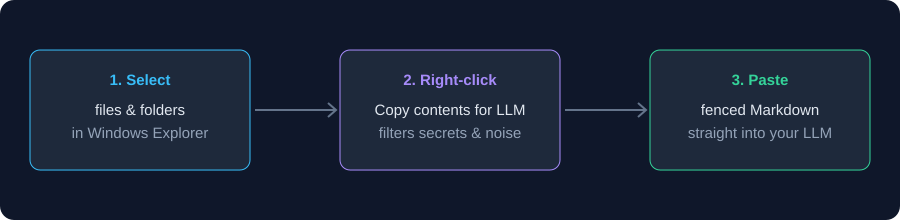
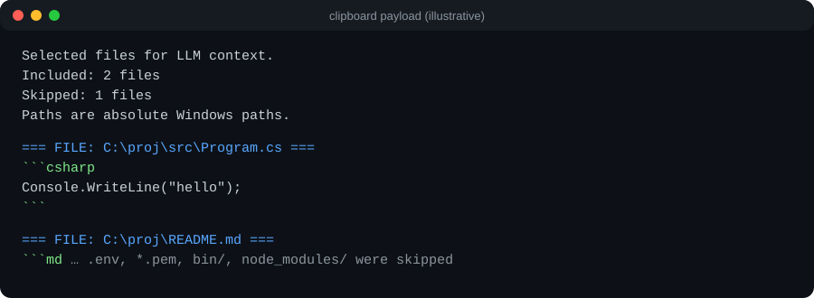

# Select-and-Concat

[](https://github.com/BTawaifi/select-and-concat/actions/workflows/build-and-test.yml)


Right-click files or folders in Windows Explorer and get one fenced Markdown payload on your clipboard, ready to paste into an LLM prompt.



## How it looks

Each file becomes a labelled block with its absolute path and a language-tagged fence. Secrets and build folders are left out.



_Both images are illustrations of the flow and output format, not screenshots._

## Usage

1. Install the MSI (see below). It registers a per-user context-menu entry.
2. Select one or more files and/or folders in Explorer.
3. Right-click and choose **Copy contents for LLM** (on Windows 11: **Show more options** first).
4. Paste into your LLM chat. A notification confirms how many files were copied; a dialog summarises anything skipped.

## Features

- **Explorer Integration**: Select files or folders in Windows Explorer, right-click, and click **"Copy contents for LLM"**.
- **Multi-Select Coordination**: Seamlessly aggregates paths across Explorer instances using non-blocking inter-process communication.
- **Smart Markdown Fencing**: Dynamically adjusts fence backticks to cleanly enclose code blocks inside Markdown files without syntax breaking.
- **Robust Text Decoding**: Automatically handles UTF-8 / UTF-16 encodings and handles mid-codepoint byte boundary truncations cleanly.
- **Credential Protection**: Automatically excludes secret files (`.env`, `.pem`, `.key`, `id_rsa`, `credentials.json`) to prevent accidental leaks to LLMs.
- **Noise Filtering**: Automatically ignores dependency and build folders (`node_modules`, `.git`, `bin`, `obj`, `dist`, `build`, etc.) during directory expansion.
- **Linear-Time Payload Building**: Fast $O(N)$ execution time with automatic size limits.
- **Visual Feedback**: Displays a system tray notification upon successful copying.

## Limits

Defaults (`ProcessingOptions`): 200 files, 5 MiB per file (longer files are truncated with a notice), 20 MiB total payload. Files beyond a limit are skipped and reported.

## Building and Installing

### Prerequisites
- .NET 8.0 SDK (building); .NET 8 Desktop Runtime (running the installed app, which is framework-dependent)
- WiX Toolset v5 (for installer build)

### Build Solution
```powershell
dotnet build SelectAndConcat.sln -c Release
```

### Run Tests
```powershell
dotnet test SelectAndConcat.sln -c Release
```

### Build & Install MSI Package
```powershell
dotnet build installer/SelectAndConcat.Installer.wixproj -c Release
msiexec /i installer/bin/x64/Release/SelectAndConcat.Installer.msi /qn
```

## License

MIT
